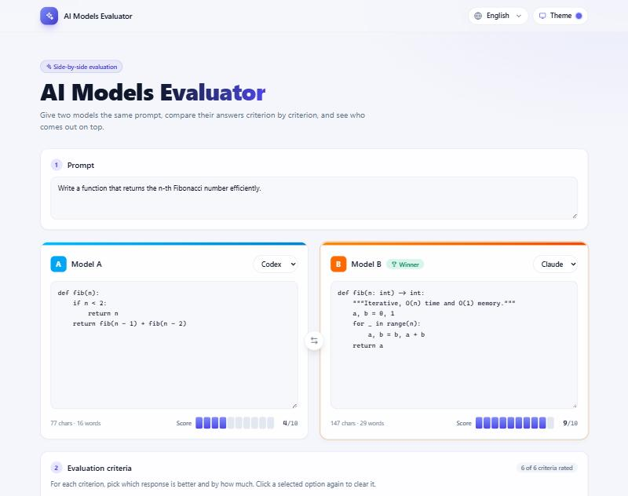
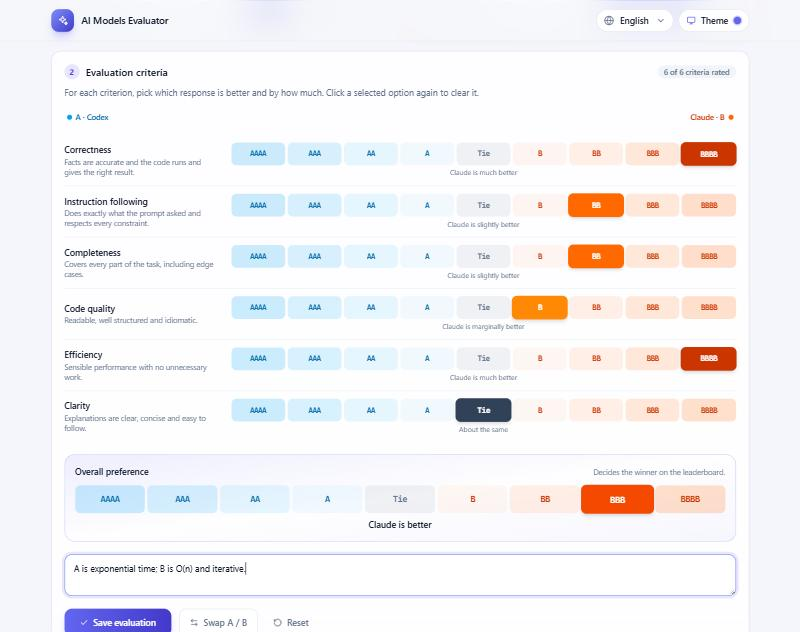
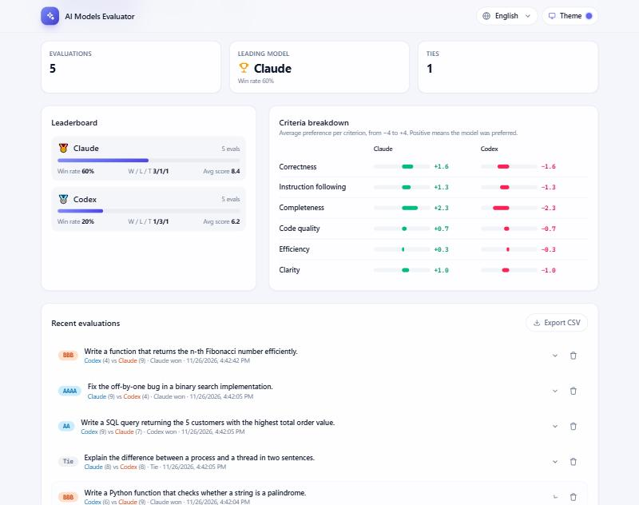
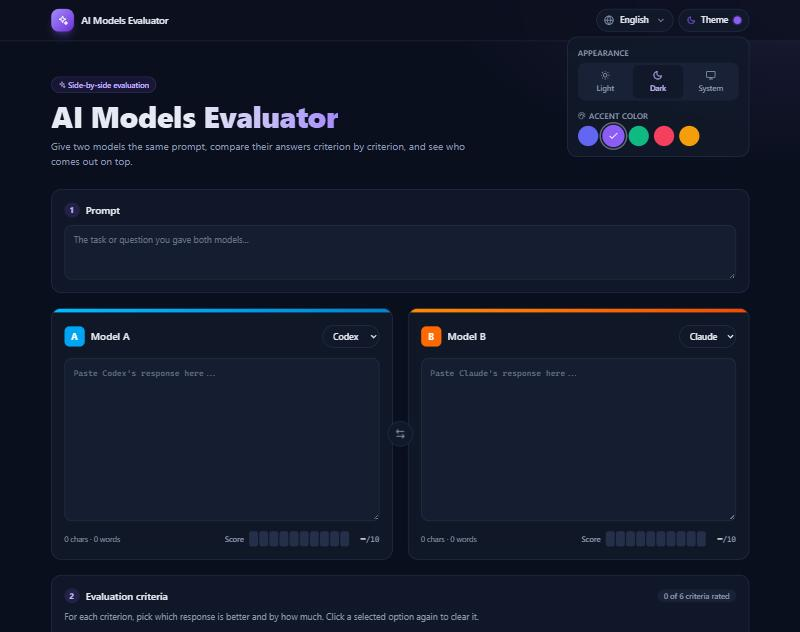
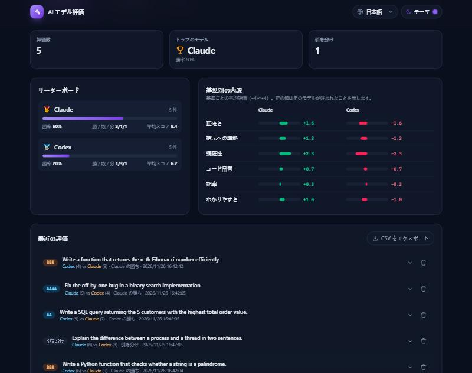

# AI Models Evaluator

A web app for comparing AI models head to head. Give two models (for example **Codex** and **Claude**) the same prompt and paste both responses side by side. Then rate them on six criteria using a 9-step **AAAA … Tie … BBBB** scale, and give an overall preference. Every comparison is saved. A leaderboard and a per-criterion breakdown show which model wins most often, and where it is stronger.

The interface comes in 5 languages, with light, dark and system themes and 5 accent colors.







| Dark theme with the theme menu | Japanese interface |
| --- | --- |
|  |  |

## Features

- **Side-by-side comparison:** one prompt, two response panels, each with its own model picker and a live character and word count.
- **Detailed criteria:** compare the two responses on **Correctness, Instruction following, Completeness, Code quality, Efficiency and Clarity**. Each one uses the preference scale below.
- **AAAA … Tie … BBBB scale:** pick how strongly one side wins. Hover over an option to see what it means.

  | Rating | Meaning |
  | --- | --- |
  | `AAAA` / `BBBB` | A / B is much better |
  | `AAA` / `BBB` | A / B is better |
  | `AA` / `BB` | A / B is slightly better |
  | `A` / `B` | A / B is marginally better |
  | `Tie` | About the same |

- **Overall preference:** the same scale for the response as a whole. It decides the winner, and the winning panel is highlighted.
- **Scores:** you can also give each response a score from 1 to 10.
- **Notes:** record why one answer was better, or any bugs you spotted.
- **Swap A / B:** flip both sides in one click. This includes every rating, so `AA` becomes `BB`.
- **Leaderboard:** summary tiles plus wins, losses, ties, win rate and average score for each model, best first.
- **Criteria breakdown:** each model's average preference for each criterion, from −4 to +4, drawn as green (preferred) or red bars.
- **History:** recent evaluations with their overall rating. Click one to see the criterion ratings, both responses and the notes, or delete it.
- **Languages:** English, Español, Français, 中文 and 日本語, switched from the header. Dates follow the chosen language.
- **Themes:** Light, Dark or System appearance, plus indigo, violet, emerald, rose or amber accent colors. The choice is saved in the browser.
- **CSV export:** download every evaluation to analyse in Excel or Google Sheets.
- **Model management:** Codex and Claude come preinstalled. Add, rename or retire models in the Django admin.
- **Validation:** the API rejects empty prompts, scores outside 1–10, unknown models or criteria, invalid ratings, and comparisons of a model against itself. Errors are shown in the UI.

The app does not call the models for you. Run the prompt in each model yourself and paste the responses in.

## Tech stack

| Part | Technology |
| --- | --- |
| Backend | Django 5.2, Django REST Framework, SQLite, django-cors-headers |
| Frontend | Next.js 16 (App Router), React 19, TypeScript, Tailwind CSS v4 |

## Project structure

```
.
├── backend/
│   ├── config/                 # Django settings and root URLs
│   ├── api/
│   │   ├── models.py           # AIModel and Evaluation
│   │   ├── serializers.py      # Validation rules
│   │   ├── views.py            # Evaluations, leaderboard, CSV export
│   │   ├── urls.py
│   │   ├── admin.py
│   │   ├── migrations/         # Includes the Codex/Claude seed
│   │   └── tests.py
│   ├── manage.py
│   ├── requirements.txt
│   └── .env.example
├── frontend/
│   ├── app/
│   │   ├── layout.tsx          # Applies saved theme before first paint
│   │   ├── page.tsx            # Home page
│   │   └── globals.css         # Light/dark colors and accent palettes
│   ├── components/
│   │   ├── Header.tsx          # Language picker and theme menu
│   │   ├── Evaluator.tsx       # Prompt, both panels, criteria, save
│   │   ├── ModelCard.tsx       # One model's response panel and score
│   │   ├── PreferenceScale.tsx # The AAAA … BBBB selector
│   │   ├── Leaderboard.tsx     # Stats, leaderboard, criteria breakdown
│   │   ├── EvaluationHistory.tsx
│   │   └── ApiStatus.tsx       # Backend connection indicator
│   ├── lib/
│   │   ├── api.ts              # Typed API client
│   │   ├── criteria.ts         # Criteria list and rating scale
│   │   ├── i18n.ts             # Translations
│   │   └── preferences.tsx     # Language, theme and accent state
│   └── .env.local.example
└── docs/screenshots/
```

## Getting started

You need Python 3.12+ and Node.js 20+.

### 1. Run the backend

```bash
cd backend
python -m venv .venv
# Windows:      .venv\Scripts\activate
# macOS/Linux:  source .venv/bin/activate
pip install -r requirements.txt
copy .env.example .env        # macOS/Linux: cp .env.example .env
python manage.py migrate
python manage.py runserver
```

The API runs at http://127.0.0.1:8000. `migrate` also adds the Codex and Claude models.

To manage models in the admin, create an account with `python manage.py createsuperuser` and open http://127.0.0.1:8000/admin/.

### 2. Run the frontend

In a second terminal:

```bash
cd frontend
npm install
copy .env.local.example .env.local   # macOS/Linux: cp .env.local.example .env.local
npm run dev
```

Open http://localhost:3000. The bar at the bottom of the page shows whether the frontend can reach the backend.

## How to use it

1. Type the prompt you gave both models.
2. Choose a model for each panel and paste its response. You can also give each a 1–10 score.
3. Under **Evaluation criteria**, pick a rating from `AAAA` to `BBBB` for each criterion. Click a selected rating again to clear it.
4. Set the **Overall preference** (this decides the winner) and add notes if you like.
5. Click **Save evaluation**. The leaderboard, criteria breakdown and history update straight away.
6. Click **Export CSV** to download all your results, including every criterion rating.

Change the language with the 🌐 menu, and the appearance and accent color with **Theme**, both in the header.

## API

All endpoints are under `http://127.0.0.1:8000/api/`.

| Method | Path | Purpose |
| --- | --- | --- |
| GET | `/api/health/` | Health check |
| GET | `/api/models/` | Active models |
| GET, POST | `/api/evaluations/` | List (`?limit=N`, `?model=Name`) or create |
| GET, PUT, PATCH, DELETE | `/api/evaluations/<id>/` | Read, update, or delete one evaluation |
| GET | `/api/evaluations/export/` | Download all evaluations as CSV |
| GET | `/api/leaderboard/` | Per-model stats, best first |

Example: create an evaluation.

```bash
curl -X POST http://127.0.0.1:8000/api/evaluations/ -H "Content-Type: application/json" -d "{\"prompt\": \"Reverse a string\", \"model_a\": \"Codex\", \"response_a\": \"s[::-1]\", \"score_a\": 7, \"model_b\": \"Claude\", \"response_b\": \"''.join(reversed(s))\", \"score_b\": 8, \"overall\": \"BB\", \"criteria\": {\"correctness\": \"TIE\", \"clarity\": \"BBB\"}, \"notes\": \"\"}"
```

Optional fields:
- `overall`: one of `AAAA`, `AAA`, `AA`, `A`, `TIE`, `B`, `BB`, `BBB`, `BBBB`. When it is set, `winner` is filled in from it.
- `criteria`: an object such as `{"correctness": "AA", "clarity": "TIE"}`. The keys are `correctness`, `instruction_following`, `completeness`, `code_quality`, `efficiency` and `clarity`.
- `winner`: `"A"`, `"B"`, `"tie"` or `""`. Only needed when `overall` is not given.

Scores are 1–10 or `null`. In `/api/leaderboard/`, each row also has a `criteria` object with that model's average preference (−4 to +4) per criterion.

## Configuration

| File | Variable | Default |
| --- | --- | --- |
| `backend/.env` | `DJANGO_SECRET_KEY` | dev key (change it for production) |
| `backend/.env` | `DJANGO_DEBUG` | `True` |
| `backend/.env` | `DJANGO_ALLOWED_HOSTS` | `localhost,127.0.0.1` |
| `backend/.env` | `CORS_ALLOWED_ORIGINS` | `http://localhost:3000,http://127.0.0.1:3000` |
| `frontend/.env.local` | `NEXT_PUBLIC_API_URL` | `http://127.0.0.1:8000` |

## Tests

```bash
cd backend
python manage.py test
```

The tests cover the model list, validation (including criteria and ratings), how the overall rating sets the winner, filtering, deletion, the leaderboard and criteria averages, and the CSV export.
