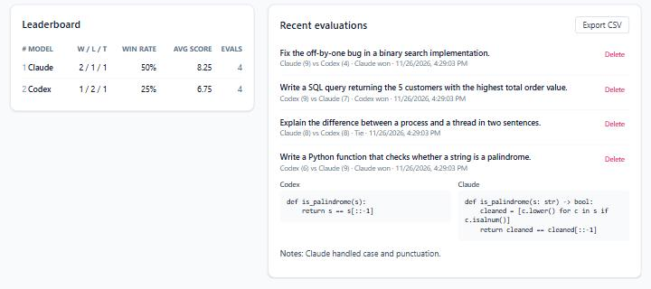

# AI Models Evaluator

A web app for comparing AI models head to head. Give two models (for example **Codex** and **Claude**) the same prompt, paste both responses side by side, score them, and pick a winner. Every comparison is saved, and a leaderboard tracks which model wins most often and scores highest over time.




## Features

- **Side-by-side comparison:** one prompt, two response panels, each with its own model picker and a live character and word count.
- **Scoring:** rate each response from 1 to 10, then mark Model A, Model B, or a tie as the winner. The winning panel is highlighted.
- **Notes:** record why one answer was better, or any bugs you spotted.
- **Swap A / B:** flip both sides (models, responses, scores and winner) in one click.
- **Leaderboard:** wins, losses, ties, win rate and average score for each model, best first.
- **History:** recent evaluations. Click one to see both responses and the notes, or delete it.
- **CSV export:** download every evaluation to analyse in Excel or Google Sheets.
- **Model management:** Codex and Claude come preinstalled. Add, rename or retire models in the Django admin.
- **Validation:** the API rejects empty prompts, scores outside 1–10, unknown models, and comparisons of a model against itself. Errors are shown in the UI.

The app does not call the models for you. Run the prompt in each model yourself and paste the responses in.

## Tech stack

| Part | Technology |
| --- | --- |
| Backend | Django 5.2, Django REST Framework, SQLite, django-cors-headers |
| Frontend | Next.js 16 (App Router), React 19, TypeScript, Tailwind CSS v4 |

## Project structure

```
.
├── backend/
│   ├── config/                 # Django settings and root URLs
│   ├── api/
│   │   ├── models.py           # AIModel and Evaluation
│   │   ├── serializers.py      # Validation rules
│   │   ├── views.py            # Evaluations, leaderboard, CSV export
│   │   ├── urls.py
│   │   ├── admin.py
│   │   ├── migrations/         # Includes the Codex/Claude seed
│   │   └── tests.py
│   ├── manage.py
│   ├── requirements.txt
│   └── .env.example
├── frontend/
│   ├── app/page.tsx            # Home page
│   ├── components/
│   │   ├── Evaluator.tsx       # Prompt, both panels, winner, save
│   │   ├── ModelCard.tsx       # One model's response panel
│   │   ├── Leaderboard.tsx
│   │   ├── EvaluationHistory.tsx
│   │   └── ApiStatus.tsx       # Backend connection indicator
│   ├── lib/api.ts              # Typed API client
│   └── .env.local.example
└── docs/screenshots/
```

## Getting started

You need Python 3.12+ and Node.js 20+.

### 1. Run the backend

```bash
cd backend
python -m venv .venv
# Windows:      .venv\Scripts\activate
# macOS/Linux:  source .venv/bin/activate
pip install -r requirements.txt
copy .env.example .env        # macOS/Linux: cp .env.example .env
python manage.py migrate
python manage.py runserver
```

The API runs at http://127.0.0.1:8000. `migrate` also adds the Codex and Claude models.

To manage models in the admin, create an account with `python manage.py createsuperuser` and open http://127.0.0.1:8000/admin/.

### 2. Run the frontend

In a second terminal:

```bash
cd frontend
npm install
copy .env.local.example .env.local   # macOS/Linux: cp .env.local.example .env.local
npm run dev
```

Open http://localhost:3000. The bar at the bottom of the page shows whether the frontend can reach the backend.

## How to use it

1. Type the prompt you gave both models.
2. Choose a model for each panel and paste its response.
3. Give each response a score and pick the winner (or Tie). Add notes if you like.
4. Click **Save evaluation**. The leaderboard and history update straight away.
5. Click **Export CSV** to download all your results.

## API

All endpoints are under `http://127.0.0.1:8000/api/`.

| Method | Path | Purpose |
| --- | --- | --- |
| GET | `/api/health/` | Health check |
| GET | `/api/models/` | Active models |
| GET, POST | `/api/evaluations/` | List (`?limit=N`, `?model=Name`) or create |
| GET, PUT, PATCH, DELETE | `/api/evaluations/<id>/` | Read, update, or delete one evaluation |
| GET | `/api/evaluations/export/` | Download all evaluations as CSV |
| GET | `/api/leaderboard/` | Per-model stats, best first |

Example: create an evaluation.

```bash
curl -X POST http://127.0.0.1:8000/api/evaluations/ -H "Content-Type: application/json" -d "{\"prompt\": \"Reverse a string\", \"model_a\": \"Codex\", \"response_a\": \"s[::-1]\", \"score_a\": 7, \"model_b\": \"Claude\", \"response_b\": \"''.join(reversed(s))\", \"score_b\": 8, \"winner\": \"B\", \"notes\": \"\"}"
```

`winner` is `"A"`, `"B"`, `"tie"`, or `""` (undecided). Scores are 1–10 or `null`.

## Configuration

| File | Variable | Default |
| --- | --- | --- |
| `backend/.env` | `DJANGO_SECRET_KEY` | dev key (change it for production) |
| `backend/.env` | `DJANGO_DEBUG` | `True` |
| `backend/.env` | `DJANGO_ALLOWED_HOSTS` | `localhost,127.0.0.1` |
| `backend/.env` | `CORS_ALLOWED_ORIGINS` | `http://localhost:3000,http://127.0.0.1:3000` |
| `frontend/.env.local` | `NEXT_PUBLIC_API_URL` | `http://127.0.0.1:8000` |

## Tests

```bash
cd backend
python manage.py test
```

The tests cover the model list, validation, filtering, deletion, the leaderboard maths and the CSV export.
